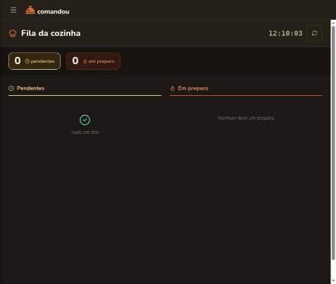
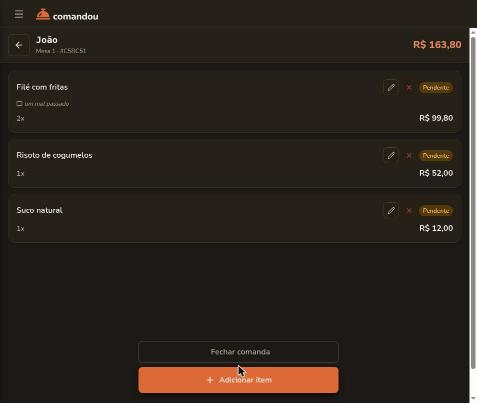

# Telas não recebem eventos do Socket.io (cozinha não atualiza ao vivo)

- **Issue:** #57 — https://github.com/Raiz-Labs/comandou-web/issues/57
- **Status:** Draft
- **Repo:** Raiz-Labs/comandou-web

## Problema

**O servidor está certo.** Ele emite `item:novo`, `item:atualizado`, `item:cancelado`, `comanda:aberta` e `comanda:fechada` para a sala `tenant:<id>`.

**As telas do web não reagem** a esses eventos:
- a fila da cozinha não mostra item novo nem remove item cancelado sem recarregar;
- o garçom não vê o item ir para "em preparo" ou "pronto";
- a notificação de item pronto não dispara;
- a lista do caixa não mostra comanda nova.

Isso quebra a proposta central do produto. A cozinha não fica sabendo dos pedidos novos e pode preparar um item que o garçom já cancelou.

### Causa provável (`src/app/core/socket/socket.service.ts`)
1. **Handler ligado cedo demais.** `on()` cria um `Observable` que, **no momento do subscribe**, chama `this.socket?.on(event, handler)` (linha ~75). Se a tela se inscreve antes de `connect()` criar o socket, essa chamada não faz nada e o handler nunca é ligado. É o que acontece na carga direta da página: o `effect` do construtor só roda depois, e o `ngOnInit` da tela já se inscreveu.
2. **Stream morto fica em cache.** O stream é guardado em `eventStreams` com `share()`. Enquanto houver um inscrito, ele não é recriado. Novas telas reutilizam o mesmo stream "morto".
3. **`item:atualizado` nunca se recupera.** `GarcomNotificacaoService` (root) se inscreve em `item:atualizado` no construtor e nunca sai, então esse stream fica morto pela sessão inteira.
4. **Reconexão com token vencido (risco).** `connect()` usa `auth: { token }` fixo. O servidor só valida o token no handshake, então uma reconexão depois de 15 min (validade do access token) falha e o socket morre até recarregar a página.

### Evidência (teste E2E em produção, 18/11/2026)
Setup: 4 abas com sessão de admin (garçom, cozinha, caixa e admin) e um cliente Socket.io cru aberto na aba da cozinha (`/socket.io/socket.io.js` da própria API, `auth: { token }`).

**Evento chega no cliente cru, mas a tela da cozinha não atualiza.** Item lançado na mesa 1:
```
cliente cru:    ["item:novo", "item:atualizado", "item:atualizado", "item:cancelado", "comanda:fechada"]
tela da cozinha: "Pendentes | Tudo em dia!"   (sem o item, até clicar em Recarregar)
API /cozinha/fila: ["Filé com fritas x2 pendente", "Risoto de cogumelos x1 pendente", "Suco natural x1 pendente"]
```


**Garçom continua "Pendente"** depois que a cozinha marcou "pronto":



**Os sintomas batem com a causa:**
- `item:novo` funcionou só na tela de comanda do garçom, aberta por navegação interna depois de o socket já existir;
- na mesma tela, `item:atualizado` não funcionou, porque esse stream já estava morto pelo serviço de notificação;
- o servidor registrou 1 conexão por aba (`Cliente conectado via WebSocket`), então o socket conecta.

## Escopo

**Dentro:**
- fazer os handlers de evento funcionarem independentemente da ordem entre subscribe e `connect()`, e também quando o socket é recriado (logout/login);
- `auth` como função em `io(...)`, para cada (re)conexão usar o token atual de `authState()`;
- testes unitários do `SocketService`:
  - subscribe **antes** do connect recebe o evento;
  - subscribe depois recebe;
  - recriar o socket mantém os inscritos;
  - reconexão usa o token mais recente.

**Fora:**
- mudanças nos componentes que assinam eventos (`fila`, `comanda-detalhe`, `mesas`, `mesa-comandas`, `comandas-lista`, `comanda-detalhe-caixa`). Eles devem continuar funcionando sem alteração;
- o payload de `item:atualizado` que o `GarcomNotificacaoService` espera (ver Questões em aberto);
- o dashboard admin ao vivo (hoje não assina eventos);
- mudanças no servidor.

## Abordagem

- **Desacoplar inscrição de conexão.** Manter um `Subject` por evento em `SocketService`. O `on(event)` devolve `subject.asObservable()`, sem depender de `this.socket`.
- **Repassar tudo para os subjects.** Em `connect()`, depois de criar o socket, registrar um único `socket.onAny((event, data) => subjects.get(event)?.next(data))`.
- **Remove a ordem de inscrição como fonte de bug.** Assim o `share()` e a limpeza de `eventStreams` no teardown deixam de ser necessários.
- **Logout e reconexão.** No `disconnect()`, o socket é descartado, mas os subjects ficam (os inscritos continuam valendo para o próximo login).
- **Token sempre atual:** `auth: (cb) => cb({ token: authState().token })`.

## Critério de aceite

- [ ] Carga direta de `/cozinha/fila`: lançar item em outra aba faz o item aparecer na fila em até 2 s, sem recarregar;
- [ ] Cancelar item no garçom remove o item da fila da cozinha ao vivo;
- [ ] Marcar "em preparo"/"pronto" na cozinha atualiza o status na comanda do garçom ao vivo;
- [ ] Abrir comanda aparece ao vivo na lista do caixa (`/caixa/comandas`) e no salão do garçom;
- [ ] Testes unitários do `SocketService` cobrem: subscribe antes de connect, subscribe depois, socket recriado, `auth` lendo o token atual;
- [ ] Depois de mais de 15 min logado, derrubar a rede e voltar: o socket reconecta e os eventos voltam a chegar.

## Questões em aberto

- **Payload incompatível na notificação.** O `GarcomNotificacaoService` lê `evento.id`, `evento.status`, `evento.produto.nome` e `evento.comanda.mesa.numero` de `item:atualizado`. A API (`avancarStatusItem`) emite só `{ itemId, status }`. Mesmo com o socket corrigido, a notificação de "pronto" sai sem nome e mesa, e o filtro por `itemId` falha. Precisa de decisão: enriquecer o payload na API, ou o web buscar o item. Deve virar uma issue própria.
