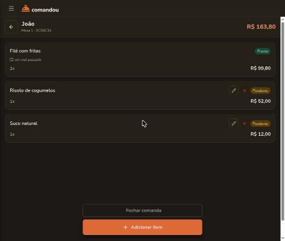

# Falta ação de marcar item como entregue

- **Issue:** #58 — https://github.com/Raiz-Labs/comandou-web/issues/58
- **Status:** Draft
- **Repo:** Raiz-Labs/comandou-web

## Problema

**O que a API já permite** (`comandou-api`, `src/modules/comanda/statusFlow.ts`):
- fluxo de status: `pendente → em_preparo → pronto → entregue`;
- o perfil `garcom` (e `admin`) pode definir `entregue` via `PATCH /comandas/:id/itens/:itemId/status`.

**O que falta no web.** Na comanda do garçom (`src/app/features/garcom/comanda/comanda-detalhe.component.ts`), cada item mostra só "Editar" e "Cancelar" (quando permitidos) e o `app-status-badge`. Nenhum botão avança `pronto → entregue`.

**Consequências:**
- o item fica "Pronto" para sempre;
- o garçom não tem como registrar a entrega;
- a mesa continua sinalizando item pronto.

### Evidência (teste E2E em produção, 18/11/2026)
Depois de a cozinha marcar "Filé com fritas" como pronto, a comanda do garçom mostra o item com o selo "Pronto" e sem nenhuma ação:

## Escopo

**Dentro:**
- botão "Entregar" (ícone e `aria-label`) nos itens com status `pronto` na comanda do garçom;
- chamada a `PATCH /comandas/:id/itens/:itemId/status` com `{ status: 'entregue' }`;
- feedback de sucesso e de erro (toast), e recarga da comanda após sucesso;
- teste unitário do componente: o botão aparece só para `pronto` e chama o serviço.

**Fora:**
- "entregar tudo" em lote;
- mudança de regra ou permissão na API;
- status da mesa (`item_pronto`) e a forma como a API o calcula;
- tela da cozinha.

## Abordagem

- **Botão no padrão existente.** Seguir `.item-action` (`item-action--edit`/`--cancel`) no `item-card__actions` e criar `item-action--entregar`, exibido quando `item.status === 'pronto'`.
- **Chamada HTTP no padrão da cozinha.** Reproduzir o que `src/app/features/cozinha/cozinha.service.ts` já faz (`this.api.patch(\`/comandas/${comandaId}/itens/${itemId}/status\`, { status })`), no serviço da comanda do garçom.
- **Sem bloquear duplo clique por estado global.** Usar o mesmo padrão de `processando` (Set de ids) da fila da cozinha.

## Critério de aceite

- [ ] Item com status `pronto` mostra o botão "Entregar"; itens em outros status não mostram;
- [ ] Clicar em "Entregar" muda o item para `entregue` e o selo passa a "Entregue";
- [ ] Erro da API (ex.: 422 de status fora de ordem) mostra toast de erro e não muda o selo;
- [ ] Clique duplo rápido gera uma única requisição;
- [ ] Teste unitário cobre a exibição condicional e a chamada ao serviço.
