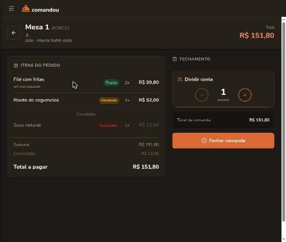

# Caixa mostra "Aberta NaNh atrás"

- **Issue:** #59 — https://github.com/Raiz-Labs/comandou-web/issues/59
- **Status:** Draft
- **Repo:** Raiz-Labs/comandou-web

## Problema

O caixa calcula há quanto tempo a comanda está aberta a partir de `comanda.criadoEm`:
- `src/app/features/caixa/comandas/comandas-lista.component.ts:136` e `tempoAberta()` na linha ~521;
- `src/app/features/caixa/comanda/comanda-detalhe-caixa.component.ts:58` e `tempoAberta()` na linha ~708.

O model `Comanda` da API (`comandou-api`, `prisma/schema.prisma`) não tem `criadoEm`, tem `abertaEm`. Sem o campo, `new Date(undefined)` vira `NaN` e a tela mostra **"NaNh"**. A interface `Comanda` do web (`src/app/shared/types/index.ts:66`) declara `criadoEm: string`, então o TypeScript não acusa nada.

### Evidência (teste E2E em produção, 18/11/2026)
- **Lista do caixa:** `Mesa 1 | #C5BC51 | NaNh | 2 itens | item pronto | R$ 151,80`.
- **Detalhe da comanda:**

## Escopo

**Dentro:**
- trocar `criadoEm` por `abertaEm` na interface `Comanda` e nos dois componentes do caixa;
- `tempoAberta()` devolve um texto neutro (ex.: "—") se a data for inválida, em vez de "NaN";
- teste unitário de `tempoAberta()`: minutos, horas e data inválida.

**Fora:**
- extrair `tempoAberta()` para um utilitário compartilhado (as duas cópias continuam);
- mudar `criadoEm` de outras entidades (itens, produtos etc.), que existem na API;
- mudanças na API.

## Abordagem

- **Interface:** em `shared/types/index.ts`, `Comanda.criadoEm` vira `abertaEm: string`, seguindo o nome real do campo na API. O compilador aponta os usos restantes.
- **Proteção contra data inválida:** em cada `tempoAberta()`, `if (Number.isNaN(diff)) return '—'`.

## Critério de aceite

- [ ] Lista e detalhe do caixa mostram o tempo correto (ex.: "12min", "1h 5min") para uma comanda recém-aberta;
- [ ] Nenhum lugar do web lê `criadoEm` de uma `Comanda`;
- [ ] `tempoAberta()` com data inválida devolve "—";
- [ ] Teste unitário cobre os três casos.
