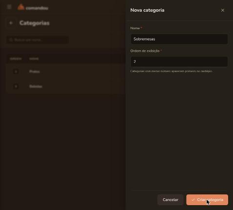
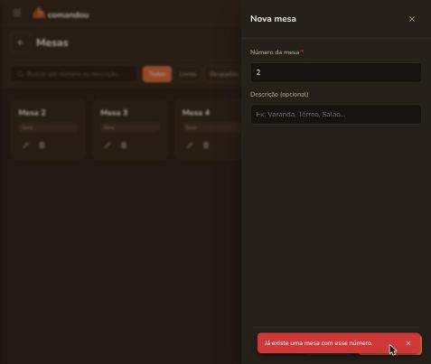

# Toast cobre o botão salvar dos painéis laterais

- **Issue:** #60 — https://github.com/Raiz-Labs/comandou-web/issues/60
- **Status:** Draft
- **Repo:** Raiz-Labs/comandou-web

## Problema

O toast (`src/app/shared/components/toast/toast.component.ts`) fica fixo no canto inferior direito (`position: fixed; bottom: var(--b-space-6); right: var(--b-space-6); z-index: var(--b-z-toast)`). É exatamente onde fica o botão primário ("Criar …"/"Salvar") dos painéis laterais de categoria, produto, mesa e usuário.

Enquanto o toast está visível, o clique no botão cai no toast e se perde sem aviso. Isso acontece:
- depois de criar um item e já abrir outro (fluxo comum ao cadastrar em sequência);
- depois de um erro de validação da API, quando o usuário corrige e tenta de novo.

### Evidência (teste E2E em produção, 18/11/2026)
- **Categoria:** a criação de "Sobremesas" logo depois de "Pratos" não fez nada no primeiro clique. O toast "Categoria criada" estava por cima do botão:

  

- **Mesa:** com o erro "Já existe uma mesa com esse número.", o toast ficou sobre "Criar mesa". O clique seguinte, já com o número corrigido, também se perdeu:

  

## Escopo

**Dentro:**
- reposicionar o toast para não cobrir o rodapé de painéis e modais;
- o toast não intercepta cliques fora do próprio card (o container não captura eventos);
- conferir em desktop e em largura de celular.

**Fora:**
- redesenho visual do toast;
- mudar a duração ou a fila de toasts;
- mudar o layout dos painéis laterais.

## Abordagem

- **Mover para o topo.** Levar o container para o topo (`top` em vez de `bottom`), centralizado no celular e no canto superior direito no desktop. É uma área sem ações primárias nas telas do app (cabeçalho), então resolve para todos os painéis sem acoplar o toast a eles.
- **Liberar cliques ao redor.** No container, `pointer-events: none`; no card, `pointer-events: auto`. O espaço em volta do toast deixa de bloquear cliques.

## Critério de aceite

- [ ] Com um toast visível, o botão primário de qualquer painel lateral (categoria, produto, mesa, usuário) responde ao primeiro clique;
- [ ] O toast não cobre o cabeçalho de ações das telas (ex.: "Nova categoria") em desktop nem em 375px de largura;
- [ ] Clicar fora do card do toast nunca é absorvido por ele;
- [ ] Fechar o toast pelo "×" continua funcionando.
