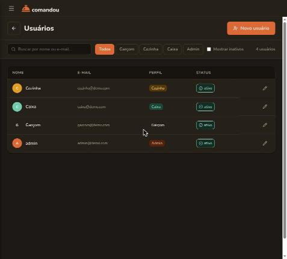
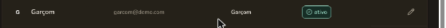
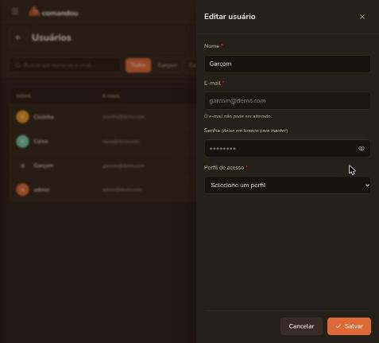

# Usuários: perfil Garçom sem cor e select de perfil vazio ao editar

- **Issue:** #61 — https://github.com/Raiz-Labs/comandou-web/issues/61
- **Status:** Draft
- **Repo:** Raiz-Labs/comandou-web

## Problema

Dois defeitos visuais em `src/app/features/admin/usuarios/usuarios.component.ts`.

### 1. Avatar e selo do perfil Garçom sem cor
O CSS usa:
- `--b-secondary-500` para o avatar (`&[data-perfil="garcom"]`, linha ~301);
- `--b-secondary-100` e `--b-secondary-700` para o selo (`.perfil-badge--garcom`, linha ~311).

Nenhuma variável `--b-secondary-*` existe no design system (`src/assets/b-system/colors_and_type.css`). As famílias disponíveis são `primary`, `accent`, `success`, `warning`, `danger`, `info` e `neutral`. Resultado: o fundo fica transparente e o texto usa a cor padrão. O garçom é o único perfil que aparece "apagado".

### 2. Select "Perfil de acesso" vazio ao editar
O select usa `[value]="model().perfil"` (linha ~229), com as opções geradas por `@for`. O `[value]` é aplicado antes de as opções existirem, então o select mostra "Selecione um perfil" ao editar **qualquer** usuário.

O valor no modelo está certo: salvar sem mexer mantém o perfil. Mas a tela dá a entender que o perfil está em branco, e o admin pode trocar o perfil sem querer.

### Evidência (teste E2E em produção, 18/11/2026)
- **Lista de usuários** (linha do Garçom sem cor no avatar e no selo):

  
  

- **Editar usuário com perfil vazio.** No DOM, `select.value === ""` com as opções `garcom|cozinha|caixa|admin` presentes:

  

## Escopo

**Dentro:**
- trocar `--b-secondary-*` por tokens existentes (sugestão: família `info` ou `accent`) e conferir contraste em tema claro e escuro;
- marcar a opção certa ao abrir a edição, com `[selected]="p === model().perfil"` em cada `<option>` (ou equivalente);
- teste unitário: abrir a edição de um usuário `garcom` deixa o select com valor `garcom`.

**Fora:**
- criar tokens `--b-secondary-*` no design system;
- mudar as cores dos outros perfis;
- mudanças no formulário de criação além do select.

## Abordagem

- **Tokens:** troca direta nas regras CSS do próprio componente.
- **Select:** `[selected]` por opção resolve a ordem de renderização sem mudar o modelo de formulário atual (signals com `onFieldInput`).

## Critério de aceite

- [ ] Avatar e selo do Garçom têm cor de fundo e texto visíveis, nos temas claro e escuro;
- [ ] Nenhuma referência a `--b-secondary-` sobra no web;
- [ ] Abrir "Editar usuário" mostra o perfil atual selecionado, para os 4 perfis;
- [ ] Teste unitário cobre o select preenchido na edição.
